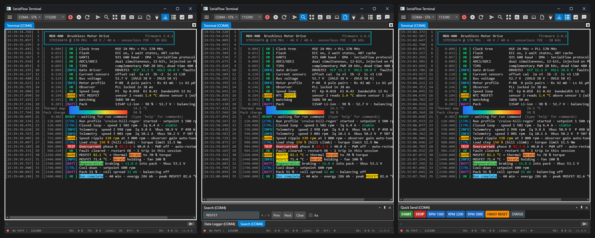

# SerialFlow

**Plug in. Pick the port. It logs.**
A serial terminal for Windows that starts as a compact UART logger and grows into real-time graphs, live status
windows and dashboards, driven by plain-text output from your firmware.

> **Pre-release (beta).** Version `0.9.0-beta.1`, 10 November 2026. It is free for now. Expect rough edges, and
> please [report what you find](../../issues/new/choose).

## Download

**[SerialFlow-win-Setup.exe (0.9.0-beta.1)](https://github.com/Lizerd/SerialFlow-Releases/releases/download/v0.9.0-beta.1/SerialFlow-win-Setup.exe)**
· all versions: [Releases](../../releases)

- Windows 11, 64-bit. Windows 10 should work but has not been tested yet.
- There is nothing else to install: .NET is built in. The installer installs for your user account only.
- The installer is not code-signed yet, so Windows SmartScreen may say *"Windows protected your PC"*. Click
  **More info → Run anyway**.
- Later versions are offered from inside the app.

More on the product page: **https://lizerd.se/serialflow/**

## What it does

- **Compact logger:** full ANSI colour, timestamps, line numbers, find, keyword highlighting, and logging to file in a
  small window
- **Status windows:** firmware updates lines of a status table in place (`~WrLi1:2:Speed 2200 rpm`)
- **Real-time graphs** from one text line per sample (`~{A:1:23.5:67.2}`): streamer, logger, oscilloscope frame and XY
  modes, with markers, statistics and run comparison
- **Dashboards:** a drag-and-drop HMI canvas with 35 widget types, or an instant signal grid
- **Automation:** Quick Send buttons, macros that wait for the device, auto-reply rules
- **Data:** record every signal to SQLite, CSV or JSON Lines; save `.sfplot` sessions; export CSV / JSON

## Report a problem or ask for a feature

Use **[Issues](../../issues/new/choose)**. A free GitHub account is enough. Please don't paste private data from your
devices.

## Licence and privacy

- [LICENSE.txt](LICENSE.txt): free to use, not open source.
- [THIRD-PARTY-NOTICES.md](THIRD-PARTY-NOTICES.md)
- [PRIVACY.md](PRIVACY.md): an update check, plus an optional anonymous daily count. No ID, no personal data.

This repository holds releases only. The source code is not public.

© 2026 Lizerd
